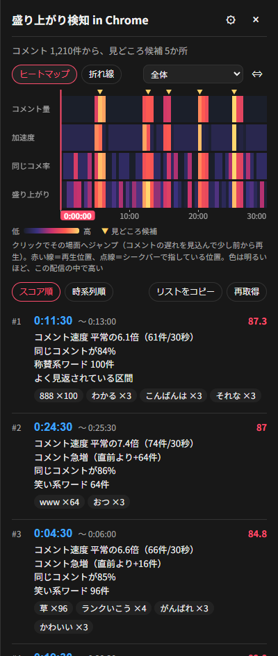
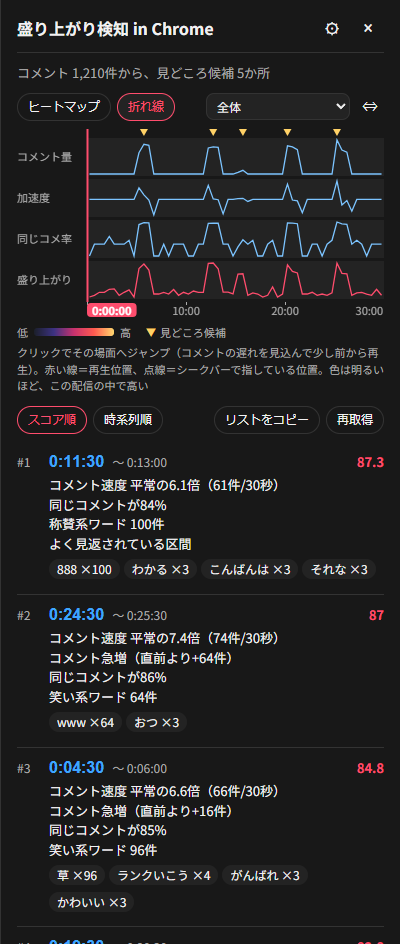
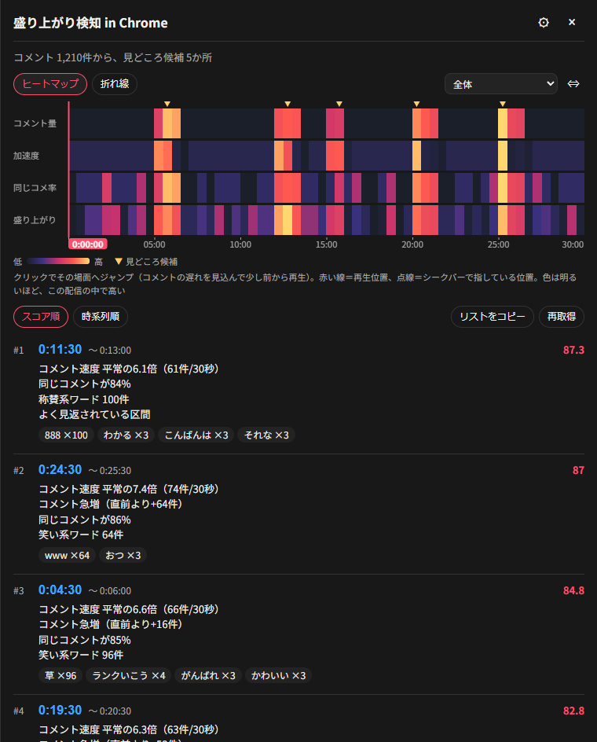
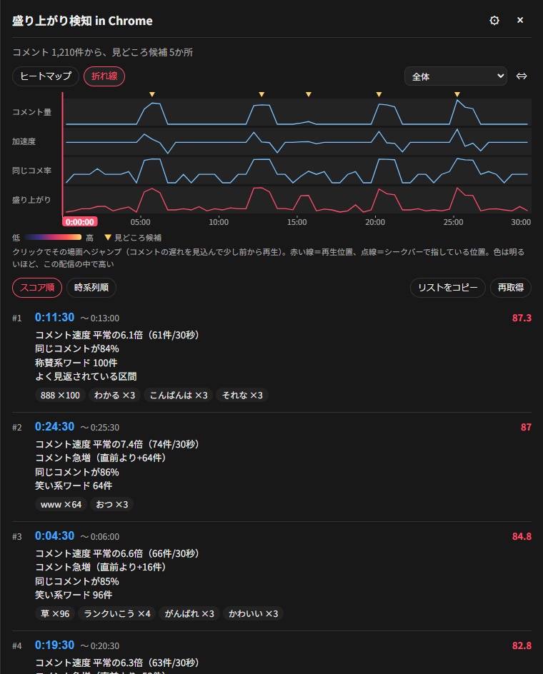

# QA-0002-toggle-layout 表示切り替えで下のボタンの位置が動かないようにする テスト結果報告

対応：REQ-0002（FB-3）／BD-0002／DD-0002／TS-0002-toggle-layout
対象：ブランチ feat/fb3-toggle-layout-impl（content.js の2行＝コミット 76087ff、E2E 追加＝f0ccd4e）。
番号について：QA-0002・TS-0002 は REQ-0001 系列（GitHub 配布）で使用済みのため、部長の決定（board.md の判断記録）で「-toggle-layout」を付けた。区別は先頭の req 欄で行う。
注：課長が直接実施した（テスト係は使っていない）。

## 結果の要約
- 速いテスト 49件、重いテスト 6件（skip なし）、共通指標仕様はすべて合格。
- 受け入れ基準 A-01〜A-11・A-13 は合格。A-12（実配信）は手動のため未実施。A-07 の見た目は社長確認待ち。
- 不合格のケースはない。
- 修正前に新テストが失敗すること（差 80px）は TS の「修正前の確認」に記録済みで、テストが実際に効いていることを確認している。

## 自動テスト
| 実行 | 結果 |
|---|---|
| `node --test "tests/unit/*.test.js"` | 合格 49件中 49件、fail 0 |
| `PYTHONUTF8=1 python -m unittest discover -s tests/e2e -v` | 合格 6件（Ran 6 tests in 19.4s、OK、skip なし） |
| `python shared/reference/metrics_ref.py --check` | 合格（「一致しています」、終了コード 0） |

重いテスト6件：test_toggle_keeps_layout、test_toggle_keeps_drawing_and_actions（新規2件）、test_panel_analysis_and_video_sync、test_live_url_shows_fab_and_analyzes、test_first_notice_shows_acks_and_stays_hidden、test_unexpected_error_shows_fixed_message（既存4件）。

## ケースごとの結果
| ID | 結果 | 備考 |
|---|---|---|
| T-E1 | 合格 | test_toggle_keeps_layout（5往復） |
| T-E2 | 合格 | 同上（4行で189px ± 1） |
| T-E3 | 合格 | 同上（広げた幅の5条件） |
| T-E4 | 合格 | 同上（near・first・second、800・500px） |
| T-E5 | 合格 | test_toggle_keeps_drawing_and_actions |
| T-E6 | 合格（保存）／社長確認待ち（目視） | 画像4枚は下記。課長が通常幅の2枚を見て、行・ラベル・▼・目盛りが描かれ、ボタンの位置が同じであることを確認。ヒートマップの行が太い見た目の可否は社長 |
| T-E7 | 合格 | 同上 |
| T-E8 | 合格 | 同上（折れ線のクリックで 14:30 ± 31秒） |
| T-E9 | 合格 | 同上（縦線・点線）。timeline_line.png が出た |
| T-E10 | 合格 | test_panel_analysis_and_video_sync（GAP_INK_JS の38px化後） |
| T-E11 | 合格 | 既存4件が通った。新規2件に pageerror なし（テストは通過） |
| DC-1 | 合格 | 49/49 |
| DC-2 | 合格 | 6/6、skip なし |
| DC-3 | 合格 | 一致 |
| DC-4 | 合格 | `git diff main -- extension/manifest.json` が空（版数 1.2.1 のまま） |
| DC-5 | 合格 | main との差分は extension/content.js と tests/e2e/test_extension_e2e.py だけ。panel.css・analyzer.js・fetcher.js・viewmodel・shared に差分なし |
| DC-6 | 合格 | content.js の差分は DD 4.1.1・4.1.2 の2行（定数 ROW_H = 38 の追加と `rh = ROW_H`）だけ |
| DC-7 | 合格 | 行の高さの式に S.mode がない（H = MARK_H + 行数×(38+3) + AXIS_H） |
| DC-8 | 合格（記録を確認） | TS に修正前の失敗（109 → 189、差 80px）の記録あり |
| M-1 | 未実施 | 実配信の確認は運用係。理由：拡張機能を読み込める実機での作業が必要 |
| M-2 | 未実施 | ブラウザのズーム 80%・125% は実機の作業 |
| M-3 | 未実施 | 明るいテーマでの目視は実機の作業 |
| M-4 | 未実施 | 再生中の体感は実機の作業 |

## 受け入れ基準ごとの合否（DD 7.8 の対応表に沿う）
| 基準 | 結果 | 根拠 |
|---|---|---|
| A-01 | 合格 | T-E1（折れ線に切り替えても位置が同じ） |
| A-02 | 合格 | T-E1（ヒートマップへ戻しても同じ） |
| A-03 | 合格 | T-E1（5往復とも基準と 1px 以内） |
| A-04 | 合格 | T-E1・T-E2（canvas の高さが両表示とも 189px） |
| A-05 | 合格 | T-E3（広げた幅 760px、1400・800・500px） |
| A-06 | 合格（自動）。M-2 は未実施 | T-E4。ズーム・表示スケーリングは手動で未了 |
| A-07 | 合格（自動）／社長確認待ち（見た目） | T-E5・T-E6。目視は社長 |
| A-08 | 合格 | T-E8（折れ線）・T-E10（ヒートマップ） |
| A-09 | 合格 | T-E9（折れ線）・T-E10（ヒートマップ） |
| A-10 | 合格 | T-E7 |
| A-11 | 合格 | T-E10・T-E11・DC-1〜DC-3・DC-5 |
| A-12 | 未実施 | M-1（実配信。運用係） |
| A-13 | 合格 | DC-4 |

## 画面画像（社長の見た目の確認用）
画像は tests/e2e/_artifacts/（git 管理外）から写した。
| 条件 | 画像 |
|---|---|
| ヒートマップ・通常幅 |  |
| 折れ線・通常幅 |  |
| ヒートマップ・広げた幅 |  |
| 折れ線・広げた幅 |  |

社長に見てほしい点：ヒートマップの行が、以前（18px）より太く（38px）なった見た目で許容できるか。

## 不合格のケース
なし。

## 未了の項目（マージ前後の扱い）
- 社長の見た目の確認（T-E6・A-07）：部長が行う。
- M-1（実配信、A-12）：マージ後に運用係。保守運用書 2.2 の 4 に確認項目を追加済み。
- M-2〜M-4：実機で社長または運用係。見た目の確認と同時に行える。
- spec-current.md の高さの項の更新：実装後に現状仕様係（部長の判断記録）。

## 環境
- OS：Windows 11 Home（10.0.26200）、Python 3.13.14、Node v26.13.0
- ブラウザ：Playwright の Chromium（E2E）
- 実施日：2026-10-30
